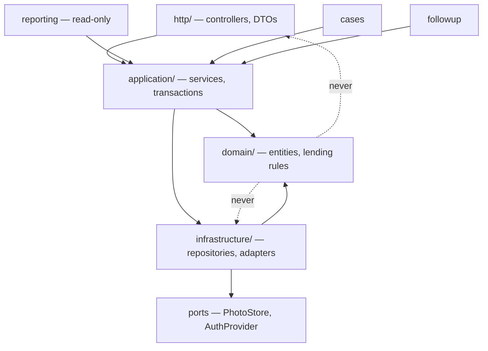
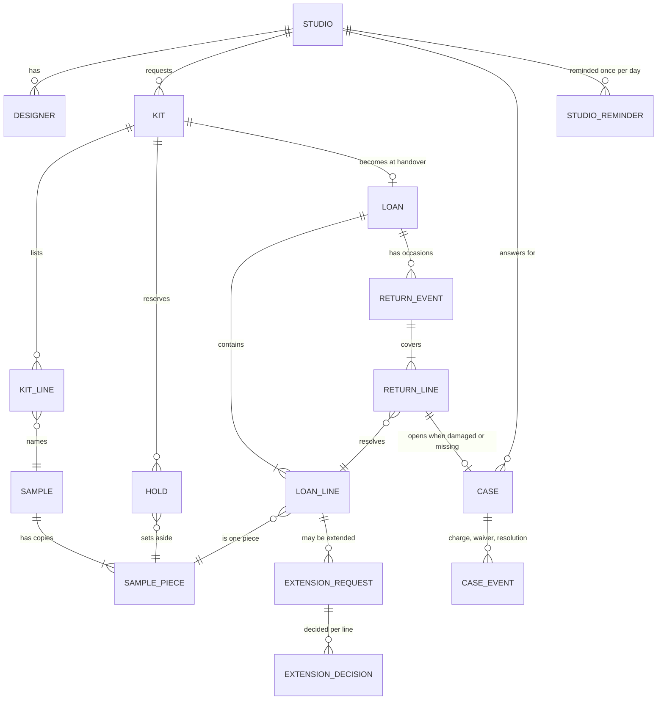
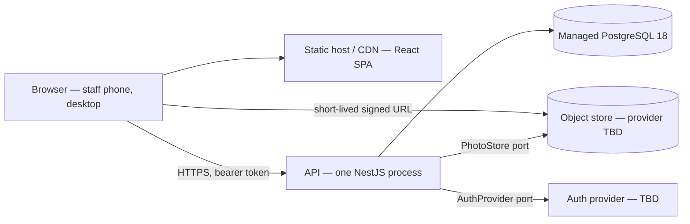

# Architecture Spine — SampleLoop

## Design Paradigm

**Hexagonal (ports and adapters) with a transactional application-service layer.**

Each module is a hexagon: a domain core of lending rules, an application service that is the only transactional entry point, repositories and provider adapters on the outside. Inbound HTTP is an adapter, not a layer the domain knows about. The two outbound ports that matter — photo storage and the auth provider — exist because the client has selected neither (Technology Discussion, both Pending), so they must be seams rather than dependencies.

Seven modules, named for what they own:

| Module | Owns | PRD feature group |
|---|---|---|
| `catalogue` | `sample`, `sample_piece` | §4.1 |
| `kits` | `kit`, `kit_line`, `hold` | §4.2 |
| `lending` | `loan`, `loan_line`, `return_event`, `return_line` | §4.3 + §4.4 |
| `followup` | `extension_request`, `extension_decision`, `studio_reminder` | §4.5 |
| `cases` | `case`, `case_event` | §4.6 |
| `reporting` | nothing — read-only | §4.7 |
| `accounts` | `user`, `studio`, `invitation` | §4.8 |

The mapping is deliberately **not** 1:1 with the PRD's feature groups. §4.3 and §4.4 collapse into one `lending` module because handover creates a Loan Line and return resolves it; splitting them would give one table two owners, which is the exact divergence this spine exists to prevent.

Inside every module: `domain/` (entities, rules, no framework imports) · `application/` (services, transactions) · `infrastructure/` (repositories, adapters) · `http/` (controllers, DTOs).

## Invariants & Rules



### AD-1 — Module boundaries are crossed through application services only

- **Binds:** all
- **Prevents:** two modules writing the same tables through their own repositories, which is how the Sample Piece invariant dies first.
- **Rule:** a module reaches another module only through that module's application service. No cross-module repository access, no cross-module Prisma model access, no shared base repository. `domain/` imports nothing from `infrastructure/` or `http/`.

### AD-2 — Sample is the design; Sample Piece is the physical copy

- **Binds:** FR-1 – FR-5, FR-33
- **Prevents:** a quantity column on `sample`, which cannot express "this specific piece came back stained" and makes FR-33 piece history unimplementable.
- **Rule:** availability, Holds, Loan Lines, Condition and Cases attach to `sample_piece`. Catalogue attributes attach to `sample`. `sample` carries no count, no quantity and no availability column.

### AD-3 — Loan Line is the unit of lending state

- **Binds:** FR-13, FR-15 – FR-22
- **Prevents:** a loan-level "returned" flag — which is precisely the spreadsheet behaviour the product exists to replace.
- **Rule:** due date, return state, overdue and extension all live on `loan_line`. `loan` has no due date and no stored status column; its state is derived from its lines, and it closes when the last line is resolved by return, loss or write-off.

### AD-4 — NFR-7 is a database constraint, not service code

- **Binds:** FR-7, FR-11, FR-15, NFR-1, NFR-7
- **Prevents:** a double-booked Sample Piece when two Staff reserve at the same moment — the failure the brief opens with.
- **Rule:** two partial unique indexes carry the invariant:

```sql
CREATE UNIQUE INDEX loan_line_one_open_per_piece
  ON loan_line (sample_piece_id) WHERE resolved_at IS NULL;

CREATE UNIQUE INDEX hold_one_active_per_piece
  ON hold (sample_piece_id) WHERE released_at IS NULL;
```

  Prisma's schema language cannot express a partial index, so both live in hand-written SQL migrations that Prisma applies but does not generate. Neither index may be dropped to make a feature easier.

### AD-5 — Contended writes are one transaction with a deterministic lock order

- **Binds:** FR-7, FR-11, FR-15, NFR-1
- **Prevents:** lost updates and deadlock between two Staff acting at the same counter, and partial commits that leave the record disagreeing with the room.
- **Rule:** reservation, handover and return each run as a single transaction at `READ COMMITTED`, taking `SELECT … FOR UPDATE` on the candidate `sample_piece` rows **in ascending piece-id order**, with AD-4's indexes as the backstop. On a unique violation the whole transaction rolls back, retries once, and then returns a structured conflict naming the competing Kit or Loan. No partial success is ever committed. Where a Kit cannot be fully reserved, the unfulfilled Samples are reported — that is a complete result, not a partial write.

### AD-6 — Studio scoping lives in the data-access layer; read models are role-specific

- **Binds:** FR-4, FR-32, FR-37, NFR-9
- **Prevents:** a new endpoint that forgets the Studio filter, and field-level redaction that leaks holder identity into a Designer's response.
- **Rule:** every repository method touching Studio-owned data takes a required `StudioScope` argument — it cannot be defaulted or omitted. Designer responses are built from their own DTOs which have no holder field at all, rather than from a shared DTO with conditional fields. Authorisation is enforced on every request server-side; hiding a control in the UI is never the enforcement.

### AD-7 — History is append-only

- **Binds:** FR-40, NFR-8
- **Prevents:** an attributed fact being edited after a dispute has started — the one thing the showroom asked for by name.
- **Rule:** event tables (`loan`, `return_event`, `return_line`, `extension_decision`, `case_event`) carry `created_at` and `created_by` and **no** `updated_at`. The application's database role is granted `INSERT` and `SELECT` only on them; the grant is part of the migration set. Corrections are new superseding rows, never edits.

### AD-8 — The showroom's calendar day governs lending time

- **Binds:** FR-8, FR-13, FR-20 – FR-25
- **Prevents:** two modules computing "overdue" differently, and UTC drift marking a piece overdue five hours early in Lahore.
- **Rule:** collection dates, expected-return dates and due dates are SQL `DATE`. Everything else is `timestamptz`. Overdue, due-soon and Hold expiry are evaluated against the current date in **Asia/Karachi**, through one shared function in `shared/clock/`; no module computes a day boundary itself.

### AD-9 — Photographs sit behind a PhotoStore port

- **Binds:** FR-17, NFR-9, PRD §6 (Privacy)
- **Prevents:** binding the pilot to a provider the client has not chosen, and publicly guessable image URLs.
- **Rule:** images never enter PostgreSQL. The port exposes `put`, `signedRead` and `delete`. A read is a short-lived signed URL minted only after the same authorisation check as the owning Case or Return Event passes. Type and size caps are enforced server-side before the `put`, and the cap is configuration, not a constant.

### AD-10 — Reminder drafting is a pure function, separate from delivery

- **Binds:** FR-24, FR-25, PRD §8.2
- **Prevents:** a future automated WhatsApp sender becoming a rewrite rather than an adapter.
- **Rule:** draft text is produced by a pure function of (Studio, its overdue Loan Lines, date) with no I/O and no dependency on any transport. Suppression is its own `studio_reminder` record keyed by Studio and showroom-local date, written by the act of generating a draft. Nothing in the backend sends a message.

### AD-11 — Availability is computed, never stored

- **Binds:** FR-3, FR-4, FR-7, NFR-2
- **Prevents:** an `is_available` flag that two modules maintain and that drifts the first time a transaction half-fails.
- **Rule:** availability for a date is derived at query time from Condition, active Holds and open Loan Lines. At the stated volume — roughly 600 Samples and 1,000 Sample Pieces — this is a small indexed query, and NFR-2's two-second budget does not justify a cache. Introducing one later requires retiring this AD, not working around it.

### AD-12 — Money is recorded, never moved

- **Binds:** FR-27, FR-28, PRD §6 (Operational)
- **Prevents:** a floating-point amount, and a waiver that erases the number the showroom may need later.
- **Rule:** a Replacement Charge is an integer in minor units with an explicit ISO-4217 currency code. A waiver is a separate nullable `(waived_at, waived_by, waiver_reason)` set on the Case that never overwrites the amount. No payment, invoice, ledger, balance or reconciliation concept exists anywhere in the schema, the API or the interface.

### AD-13 — Lending state changes are named operation endpoints, not field writes

- **Binds:** FR-7, FR-9, FR-11, FR-15, FR-18, FR-21, FR-29
- **Prevents:** a client flipping a status field and bypassing the rules the application service exists to apply.
- **Rule:** every state change is a `POST` to a named sub-resource — `POST /kits/{id}/reservation`, `POST /kits/{id}/handover`, `POST /loans/{id}/return-events`, `POST /extension-requests/{id}/decisions`, `POST /cases/{id}/resolution`. No `PATCH` ever writes a state or status field.

### AD-14 — The stack is provisional, and the spine says which parts depend on it

- **Binds:** all
- **Prevents:** the delivery team reading an unapproved proposal as an approved decision. The Technology Discussion's decision record is unsigned, every row reads *Pending*, and a Python or .NET backend is explicitly still open.
- **Rule:** AD-2, AD-3, AD-4, AD-7, AD-8, AD-11, AD-12 and AD-15 are language-neutral and survive a change of backend. AD-1's module mapping and the Prisma migration mechanics inside AD-4 are the only stack-specific calls; they are the ones to revisit if the client chooses otherwise. Nothing else in this spine needs to move.

### AD-15 — One module owns each table

- **Binds:** all
- **Prevents:** the hole AD-1 leaves open on its own — `cases` resolving a Sample Piece, and `followup` moving a due date, both reach into another module's tables unless this is stated.
- **Rule:** the ownership table under *Design Paradigm* is the whole list. `cases` calls `catalogue.retirePiece` / `catalogue.restorePiece`; `followup` calls `lending.applyExtension`; `reporting` has no write path at all and reads only through owning-module query services.

## Consistency Conventions

| Concern | Convention |
|---|---|
| Naming — entities | The PRD §3 glossary verbatim: Sample, Sample Piece, Studio, Kit, Hold, Loan, Loan Line, Return Event, Extension, Case, Replacement Charge, Reminder Draft. "Item", "product", "borrower", "order" and "booking" appear nowhere in code, schema, API or UI. |
| Naming — code | Tables `snake_case` singular (`sample_piece`); TypeScript types `PascalCase` matching the glossary (`SamplePiece`); endpoints plural kebab-case (`/sample-pieces`). |
| Identity | UUIDv7 surrogate primary keys everywhere — ordered, non-enumerable. A Sample Piece's *business* identity is `(sample.reference_code, piece_number)` under its own unique constraint, and that pair is what the UI renders (`FB-2214 / 2`). No sequential integer is ever exposed. |
| Dates & times | `DATE` for collection, expected-return and due dates; `timestamptz` for everything else; ISO-8601 in JSON. Day boundaries resolve in Asia/Karachi (AD-8). |
| Errors | One envelope: `{ code, message, conflict? }`, where `conflict` names the competing entity, its id, a human label and the relevant date — because EXPERIENCE.md requires the UI to say *"held for Noor Studio, collecting Mon 20 Oct"*, which a bare 409 cannot support. Conflict codes are a closed enumeration shared with the frontend through `packages/contracts`. |
| State mutation | Through an application service, inside one transaction, via a named operation endpoint (AD-5, AD-13). Nothing mutates lending state outside that path, including seed scripts and admin tooling. |
| Auth | The auth provider is an adapter. A guard resolves one principal shape `{ userId, role, studioId? }` from the token; `StudioScope` is derived from it and is a required repository argument (AD-6). Role checks are server-side on every request. |
| Logging | Structured JSON with request id and actor id (NFR-11). Never logged: signed photo URLs, Studio or Designer contact numbers, authentication tokens. |
| Config | Environment variables only; no secret in the repository. Provider adapters are selected by configuration so the unselected providers stay swappable. |
| Migrations | Prisma Migrate owns schema change. The partial indexes (AD-4) and the append-only grants (AD-7) are hand-written SQL migrations, checked in, and never edited after they have been applied. |

## Stack

Verified on the web 2026-10-16; exact minors pinned at install. **Proposed, not client-approved** — see AD-14.

| Name | Version |
|---|---|
| Node.js | 26 LTS |
| TypeScript | 5.x |
| NestJS | 12.x |
| Prisma ORM | 7.x |
| PostgreSQL | 18 |
| React | 19.2.x |
| Tailwind CSS | 4.3.x |
| shadcn/ui | unversioned (components copied in) |
| Vite | current major at install |

Node 24's active LTS support ended 2026-10-20 and Node 26 enters Active LTS on 2026-10-28, so a project starting now binds 26 rather than a line whose active window has just closed. PostgreSQL 19 was planned for September–October 2026 but its GA could not be confirmed; the pilot stays on 18 and does not chase it.

## Structural Seed

### Core entities



`sample` has no quantity column (AD-2). `loan` has no due date and no status column (AD-3). `case` keeps its amount alongside its waiver (AD-12).

### Deployment and environments



Three environments — local, staging, production — from one codebase, differing only in configuration. One region, client-owned service accounts with developer access; provider, region and budget are the client's to decide and are not assumed here. Service window is showroom business hours with a short overnight maintenance window; a nightly backup is the floor and point-in-time recovery is desirable, but no RTO or RPO number exists yet (PRD §10 item 7), so none is stated. Fifteen simultaneous users and ~1,000 Sample Pieces mean a single API process is correct for the pilot; horizontal scale is a non-problem and designing for it would be waste.

### Source tree

```text
sampleloop/
  apps/
    api/
      prisma/
        schema.prisma
        migrations/          # includes hand-written SQL: partial indexes (AD-4), grants (AD-7)
      src/
        modules/
          catalogue/         # sample, sample_piece
          kits/              # kit, kit_line, hold
          lending/           # loan, loan_line, return_event, return_line
          followup/          # extension_request, extension_decision, studio_reminder
          cases/             # case, case_event
          reporting/         # read-only; dashboard, history, studio view, CSV export
          accounts/          # user, studio, invitation, roles
        shared/
          clock/             # Asia/Karachi day boundaries (AD-8)
          ports/             # PhotoStore, AuthProvider
          errors/            # conflict envelope
    web/                     # React SPA — see EXPERIENCE.md for IA, DESIGN.md for tokens
  packages/
    contracts/               # request/response types and the conflict-code enumeration
```

Each `modules/<name>/` holds `domain/`, `application/`, `infrastructure/`, `http/`.

## Capability → Architecture Map

| Capability / Area | Lives in | Governed by |
|---|---|---|
| §4.1 Sample Catalogue and Availability (FR-1 – FR-5) | `catalogue` | AD-2, AD-11, AD-15 |
| §4.2 Kit Requests and Reservations (FR-6 – FR-10) | `kits` | AD-4, AD-5, AD-8, AD-13 |
| §4.3 Collection and Handover (FR-11 – FR-14) | `lending` | AD-3, AD-4, AD-5, AD-7, AD-13 |
| §4.4 Returns and Condition (FR-15 – FR-19) | `lending` | AD-3, AD-7, AD-9, AD-13 |
| §4.5 Extensions and Overdue Follow-up (FR-20 – FR-25) | `followup` | AD-8, AD-10, AD-15 |
| §4.6 Damage and Loss Cases (FR-26 – FR-30) | `cases` | AD-9, AD-12, AD-15 |
| §4.7 Dashboard, History and Export (FR-31 – FR-35) | `reporting` | AD-11, AD-15 |
| §4.8 Accounts, Roles and Audit (FR-36 – FR-41) | `accounts` | AD-6, AD-7 |

## Deferred

| Deferred | Why it can wait |
|---|---|
| Automated WhatsApp sending | Out of MVP scope (PRD §8.2) and unfunded (no paid service approved). AD-10 keeps it an adapter when it comes. |
| Barcode / QR identification | PRD §8.2. Reference-code entry is the fast path; AD-13's endpoints do not change if a scanner is added. |
| Per-Sample replacement values | PRD §8.2 — requires the showroom to value ~600 Samples first. AD-12's column shape already supports a default. |
| Forward booking — more than one Hold per piece | PRD §8.2. AD-4's partial index is what would have to change, deliberately. |
| Caching or materialising availability | AD-11 says the volume does not justify it. Revisit only if NFR-2 is measured as missed. |
| Horizontal scale, queues, background workers | Fifteen concurrent users. A second process would be complexity bought for nothing. |
| Urdu / RTL / any localisation | NFR-5 — English only in v1, with strings kept out of markup so it is not a rewrite later. |
| Offline mode, native apps, push | PRD §7 non-goals. |
| RTO / RPO numbers, retention periods | PRD §10 item 7 — the client has not answered. The deployment shape is stated; the numbers are theirs. |
| Hosting, auth and object-storage provider selection | All *Pending* in the Technology Discussion. AD-9 and the AuthProvider port are the seams that keep this deferrable. |
| CI/CD pipeline detail, test tooling choice | Owned by the code once it exists; nothing here constrains two units to differ. |
| Photograph retention and deletion responsibility | PRD §10 item 5 — a policy decision, not an architectural one, though AD-9's `delete` exists for it. |

## Open Questions

| # | Question | What it moves |
|---|---|---|
| PRD §10 Q2 | Can a Designer see loans requested by colleagues in the same Studio? Assumed **yes**. | The only open question that moves an AD: if the answer is no, AD-6's `StudioScope` narrows to a `DesignerScope` and the Designer read models change shape. Worth answering before `accounts` and `reporting` are built. |
| PRD §10 Q1 | Hold expiry window. Assumed one day after the collection date. | A constant in `kits`, plus AD-8's evaluation. No structural change. |
| PRD §10 Q3 | Reminder cadence, and whether automated sending is a pilot requirement. | Cadence is a key in `studio_reminder`. Automated sending would promote AD-10's pure function to a port with an adapter — which is why AD-10 is written as it is. |
| PRD §10 Q4 | Replacement charge typed per Case, or stored per Sample? | A nullable default column on `sample`. AD-12 holds either way. |
| PRD §10 Q5 | Photograph types, size cap, retention, deletion responsibility. | Configuration behind AD-9, except retention, which needs a policy before a job can enforce it. |
| PRD §10 Q10 | The showroom's colour-family vocabulary. | An enumeration in `catalogue` driving FR-5 alternatives. Needs the showroom, not the architect. |
| PRD §10 Q12 | The demonstration UI referred to in the Technology Discussion is not in this workspace. | If it appears, treat it as presentation only; the addendum is explicit that its data layer is a rebuild, not a port. |
